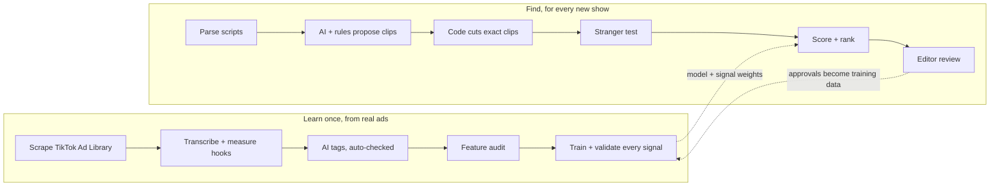

# Promo Finder

**Finds the clips that make strangers stop scrolling, ranked by what won in real ads.**

Promo Finder reads a microdrama's episode screenplays and returns ranked 20–60 second promo clips for TikTok, Reels and Shorts. Each clip:
- opens on a hook in the first 3 seconds
- cuts on a cliffhanger
- makes sense to someone who has never seen the show

It gives exact episode timestamps an editor can cut from.


---

## Contents
- [What it does](#what-it-does)
- [Run it on your computer](#run-it-on-your-computer)
- [Using the web app](#using-the-web-app)
- [What you get](#what-you-get)
- [How it works](#how-it-works)
- [The data behind the ranking](#the-data-behind-the-ranking)
- [Results on a 50-episode show](#results-on-a-50-episode-show)
- [Rebuild the dataset or retrain the model](#rebuild-the-dataset-or-retrain-the-model)
- [Project structure](#project-structure)
- [Troubleshooting](#troubleshooting)
- [Data and confidentiality](#data-and-confidentiality)

---

## What it does

| Input | Output |
|---|---|
| A folder (or `.zip`) of episode screenplays as `.txt` files, with timestamps for every scene, line and action | Ranked promos. Each one has the episode and start–end time of every segment, the hook, the cliffhanger, one line on why it works, the episode to send viewers to, and a score breakdown |

- Promos can be one continuous stretch or a **montage** of up to 3 moments across episodes.
- An editor reviews the picks in a web app and approves or rejects each one. Those decisions are saved as new training data.

---

## Run it on your computer

### 1. What you need
- **Python 3.10 or newer** (tested on 3.12 and 3.13). Check with `python --version`.
- About 300 MB of disk space for the Python packages.
- **Optional:** an API key for Claude ([console.anthropic.com](https://console.anthropic.com/)) and/or Gemini ([aistudio.google.com/apikey](https://aistudio.google.com/apikey), which has a free tier). **Without any key the tool still works**, in rule-based mode.

### 2. Get the code
```bash
git clone https://github.com/shreyansh2004/PromoFinder.git
cd PromoFinder/promo-finder
```
No Git? On GitHub click **Code → Download ZIP**, unzip it, and open a terminal in the `promo-finder` folder.

### 3. Create an environment and install

**Windows (PowerShell)**
```powershell
python -m venv .venv
.venv\Scripts\pip install -r requirements.txt
```

**macOS / Linux**
```bash
python3 -m venv .venv
.venv/bin/pip install -r requirements.txt
```
`requirements.txt` includes the training libraries. If you only want to run the app, `requirements-app.txt` is smaller.

### 4. Add your API keys (optional)
Copy the example settings file and fill in the keys you have:

```powershell
copy .env.example .env      # Windows
```
```bash
cp .env.example .env        # macOS / Linux
```

Then open `.env` in a text editor:
```ini
LLM_PROVIDERS=claude,gemini
ANTHROPIC_API_KEY=your-claude-key
CLAUDE_MODELS=claude-sonnet-5-5
GEMINI_API_KEY=your-gemini-key
GEMINI_MODELS=gemini-3.5-flash,gemini-flash-latest
```
`.env` stays on your computer and is never committed. You can add or change keys while the app is running; the next run picks them up.

### 5. Start the app

**Windows**
```powershell
.venv\Scripts\python -m uvicorn app:app --port 8000
```

**macOS / Linux**
```bash
.venv/bin/python -m uvicorn app:app --port 8000
```
Open **http://localhost:8000** in your browser. Stop the server with `Ctrl + C`.

---

## Using the web app

1. **Add the scripts.** Drag episode `.txt` files (or one `.zip`) onto the drop area. Or, when running locally, paste the path of a folder that contains them.
2. **Set up the run:**
   - **Show name:** used in the results and exports.
   - **Promos to return:** 5–40 (default 15).
   - **Episodes (optional):** a subset such as `1-5` or `1,3,10-12`, handy for a quick test.
   - **Use AI model:** turn it off for the free rule-based mode.
   - **Model dropdown:** *Automatic* uses your failover order; picking a model puts it first.
3. Click **Find promos.** Progress appears step by step. A full 50-episode show takes about 3 minutes with AI, or a few seconds in rule-based mode.
4. **Review the results:**
   - **Episode ribbon** (top): where each promo sits in the show; click a tick to open it.
   - **Ranked list** (left).
   - **Phone preview** (centre): the clip as a 9:16 script. The **pink zone** is the first 3 seconds (the hook) and the **green line** is the cut (the cliffhanger).
   - **Detail panel** (right): hook, cliffhanger, why it works, what a stranger understood, the score breakdown, tags, the episode to send viewers to, and a cut list.
5. **Decide.** Click **Approve** or **Reject** (add a note if you like). Decisions are saved to `feedback/feedback.csv`.
   - Keyboard: `j` / `k` move through the list, `a` approves, `r` rejects.
6. **Export** with **Download CSV**, **Report** (Markdown with transcripts) or **JSON**.
7. **"What wins in real ads"** (top tab) shows the evidence behind the ranking: how each signal was tested on real ads, and win rates by hook type and by what is on screen.

---


## What you get

Each run writes three files:

| File | Contents |
|---|---|
| `promos.csv` | The ranked list: segments (episode, start–end), duration, hook, cliffhanger, why, scores, landing episode, flags |
| `report.md` | A readable report with every promo's transcript, plus any rejected AI proposals and why |
| `promos.json` | Everything: segments, scores and weights, tags, the stranger test's comments, cut lists (`ffmpeg -ss … -to …`), the series bible, run statistics |

`model/verify_outputs.py` re-reads the screenplays and checks every promo:
- each timestamp is a real script boundary
- no line of dialogue is cut mid-sentence
- each clip runs 20–60 seconds
- something happens in the first 3 seconds

---

## How it works



| Step | Done by | What happens |
|---|---|---|
| Parse | Code | Screenplays become timestamped beats (camera, action, dialogue, sound). The parser tolerates format differences between episodes. |
| Series bible | AI, 1 call | Premise, characters and their aliases, turning points, continuity problems |
| Find moments | AI + rules | The AI reads a few episodes at a time and proposes clips and cross-episode montages by **beat ID only**, so it never writes a timestamp. Rule-based candidates are always added. |
| Cut | Code | Beat IDs become exact times. Cuts land on shot boundaries and never mid-line; clips are 20–60 s with the hook inside 3 s; duplicates are removed and over-long picks repaired. |
| Stranger test | AI | A cold reader sees **only the clip** and rates the hook, the cliffhanger and whether it makes sense alone, saying what confused them |
| Score + rank | ML + code | The ad-success model scores each opening. All signals are combined with weights earned from tests on real ads, then the picks are spread across episodes. |
| Review | Human | The editor approves or rejects; decisions are saved as training data |

---

## The data behind the ranking

**Dataset** ([`dataset/`](dataset/), details in its [README](dataset/README.md))
- **936 real short-drama ads** from TikTok's public Ad Library (the EU/UK transparency archive): ReelShort, DramaBox, ShortMax, NetShort, My Drama, DramaWave and others. Collected across 12 monthly windows, with official reach bands and first and last shown dates.
- **Transcripts:** each ad's opening and ending, transcribed locally with Whisper.
- **Visual hooks:** OpenCV measured the first 3 seconds (shot cuts, motion, face close-ups, loudness), so silent visual hooks count too.
- **Tags:** **308 unique English drama ads** tagged by ChatGPT (genre, tropes, hook type, ending type, what is on screen). An automated checker verified every tag against the real transcript.

**Model** ([`promo-finder/model/`](promo-finder/model/), full report: [`training_report.md`](promo-finder/model/artifacts/training_report.md))
- **Algorithm:** logistic regression predicting whether an ad's opening behaves like a high-reach ad (100K+ unique users) or a low-reach one (under 10K).
- **Audit before training:**
  - leakage
  - rare features
  - correlated inputs (|r| > 0.7)
  - Cramér's V between tags
  - VIF < 5
  - a source-bias check, so the model compares ads within the same app and learns the hook, not the brand
- **Readable:** saved as plain JSON ([`model_full.json`](promo-finder/model/artifacts/model_full.json)).

**Every ranking signal was tested on 221 real ads**, comparing winners and losers from the same app. Each signal's weight in the final score comes from that test ([`signal_validation.json`](promo-finder/model/artifacts/signal_validation.json)). The AI stranger test ranks the higher-reach ad first 61% of the time overall and **72% on US-style apps like ReelShort**.

---

## Results on a 50-episode show

| | |
|---|---|
| Episodes read | 50 (3,727 timestamped beats) |
| Candidate clips → ranked promos | 104 → 15 (including cross-episode montages) |
| Time / cost with Claude Sonnet 5.5 | about 3 minutes, about $1 |
| Rule-based mode | about 4 seconds, $0 |
| Automated output checks | 106 / 106 passed |

The promos themselves quote the show's scripts, so they are not published here.

---

## Rebuild the dataset or retrain the model

You don't need these steps to use the app; the trained model ships with the repo.

```bash
cd promo-finder

# Retrain the ad-success model from the tagged dataset (writes model/artifacts/)
python model/train.py ../dataset/data/ads_dataset_tagged.csv

# Re-test every ranking signal on real ads (calls the AI for the stranger test; cached)
python model/validate_signals.py ../dataset/data/ads_dataset_tagged.csv ../dataset/data/transcripts 4
```
The dataset pipeline (scraping, transcription, visual measurements, ChatGPT tagging and its checks) has its own requirements and step-by-step commands in [`dataset/README.md`](dataset/README.md) and [`dataset/gpt/PROMPTS.md`](dataset/gpt/PROMPTS.md).

---

## Project structure

```
PromoFinder/
├── promo-finder/                 the tool
│   ├── app.py                    web server (FastAPI)
│   ├── cli.py                    command line
│   ├── promofinder/
│   │   ├── parser.py             screenplay → timestamped beats
│   │   ├── candidates.py         AI + rule-based clip proposals, montages
│   │   ├── clips.py              exact cuts: shot edges, 20–60 s, hook ≤ 3 s
│   │   ├── heuristics.py         transparent script signals
│   │   ├── features.py           features shared by training and prediction
│   │   ├── ranker.py             stranger test, model scores, weights, diversity
│   │   ├── llm.py                provider router with failover and cache
│   │   ├── prompts.py            every AI prompt in one place
│   │   └── pipeline.py           end-to-end run + exports
│   ├── static/                   web interface (HTML, CSS, JS)
│   ├── model/                    training, validation, verification scripts + artifacts
│   ├── requirements.txt          full (app + training)
│   ├── requirements-app.txt      app only (used when hosted)
│   ├── Dockerfile
│   └── .env.example              settings template
├── dataset/                      how the training data was built (scripts, tags, checks)
├── submission/raw_outputs/       model evidence (training report, validation, heatmap)

```

---

## Troubleshooting

| Problem | Fix |
|---|---|
| The engine shows "rule-based mode" | No API key was found. Add `ANTHROPIC_API_KEY` or `GEMINI_API_KEY` to `promo-finder/.env`, then start a new run. |
| `404` for a model in the log | That model is retired for your key. The router skips to the next one automatically; update `CLAUDE_MODELS` / `GEMINI_MODELS` in `.env` to remove it. |
| Many `429` / "rate-limited" messages | Free tiers have small quotas. The router pauses that provider and switches. Add a second provider, raise `GEMINI_MIN_GAP_S`, or lower `LLM_CONCURRENCY`. |
| "No .txt screenplay files found" | Upload the episode `.txt` files themselves, or a `.zip` of them. |
| Port 8000 is already in use | Start on another port: `--port 8001`, then open http://localhost:8001. |
| A run is slow | The first AI run of a show takes about 3 minutes; repeats are instant thanks to the cache. Use `--episodes 1-5` for quick tests. |

---
